# TOTVS — Demonstração de componentes Angular

## Introdução

Projeto desenvolvido para o desafio técnico de Front-end da TOTVS, com o objetivo de criar dois componentes reutilizáveis em Angular: **Select** e **Switch**.

O desafio propõe implementar os componentes com base nos handoffs fornecidos, considerando sua estrutura visual, estados de interação, comportamento e requisitos de acessibilidade. Ambos devem permitir integração com formulários por meio de `ngModel` e Reactive Forms.

Além dos componentes, o projeto apresenta uma aplicação de demonstração na qual é possível modificar propriedades e acompanhar as alterações em tempo real. Cada componente possui uma página dedicada, com uma área de visualização e controles para explorar seu funcionamento.

A implementação utiliza `ControlValueAccessor` para integrar os componentes à API de formulários do Angular.

Link em produção:
**[https://brecori.github.io/totvs-test/](https://brecori.github.io/totvs-test/)**

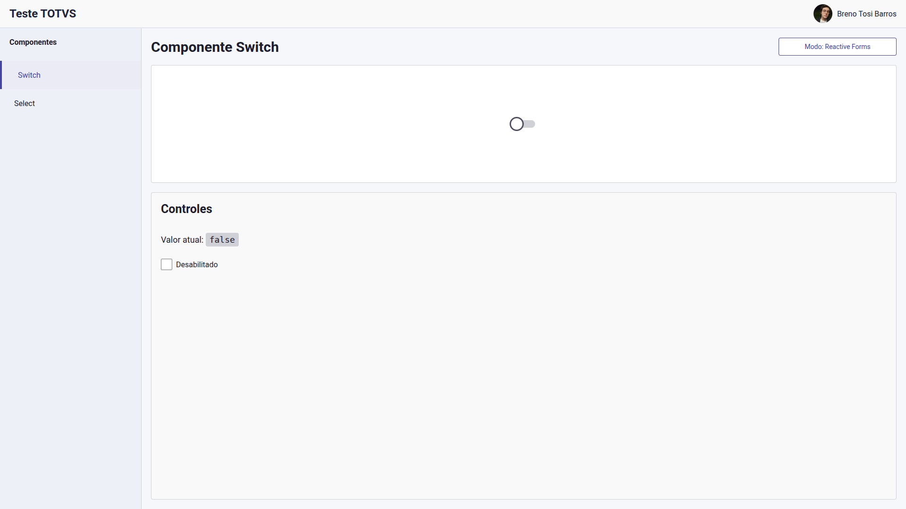

## Tecnologias utilizadas

| Tecnologia      | Finalidade                                          |
| --------------- | --------------------------------------------------- |
| Angular 22      | Desenvolvimento dos componentes e da aplicação      |
| TypeScript      | Tipagem dos dados e implementação da lógica         |
| SCSS            | Estilização dos componentes e adaptação dos layouts |
| Angular Forms   | Integração com `ngModel` e Reactive Forms           |
| Angular Router  | Navegação entre as páginas de demonstração          |
| Angular Signals | Gerenciamento de estados reativos                   |
| GitHub Actions  | Automação do build e da publicação                  |
| GitHub Pages    | Hospedagem da aplicação                             |

## Como rodar

### Pré-requisitos

- Git instalado.
- Node.js `24.16.0`, versão utilizada no workflow de deploy.
- npm disponível no ambiente.

### Instalação

Clone o repositório:

```bash
git clone https://github.com/Brecori/totvs-test.git
```

Acesse a pasta do projeto:

```bash
cd totvs-test
```

Instale as dependências a partir do arquivo de lock:

```bash
npm ci
```

### Executar localmente

Inicie o servidor de desenvolvimento:

```bash
npm start
```

A aplicação ficará disponível em:

```text
http://localhost:4200/
```

A página será atualizada automaticamente ao salvar alterações nos arquivos do projeto.

### Gerar o build

Para gerar a versão de produção:

```bash
npm run build
```

Os arquivos publicáveis serão gerados em `dist/totvs-test/browser/`.

## Páginas

A aplicação possui páginas dedicadas ao Select e ao Switch, acessíveis pelo menu de navegação.

Em ambas, é possível alternar entre **ngModel** e **Reactive Forms** para experimentar a integração dos componentes com as duas abordagens de formulários do Angular.

### Select

#### Desktop

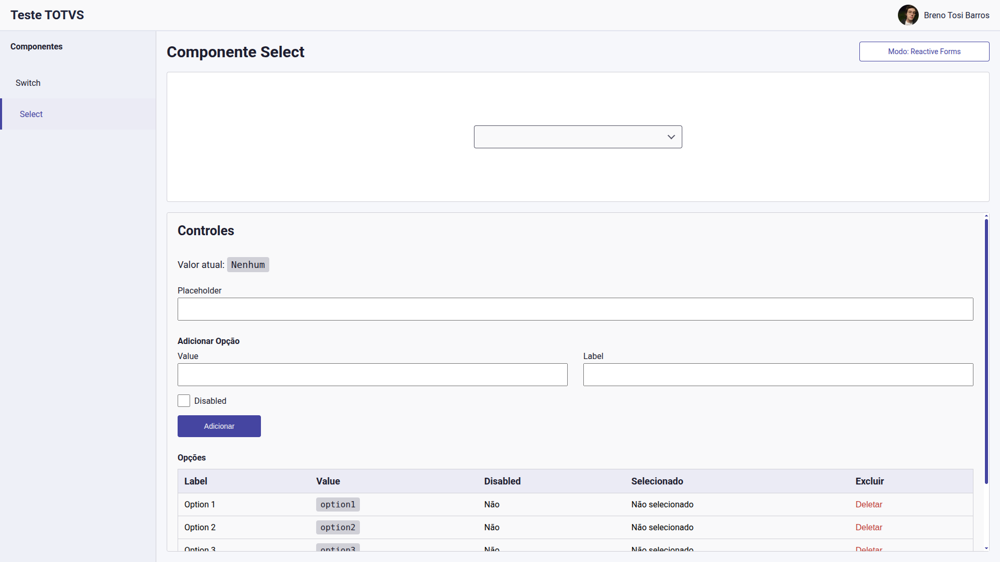

#### Mobile

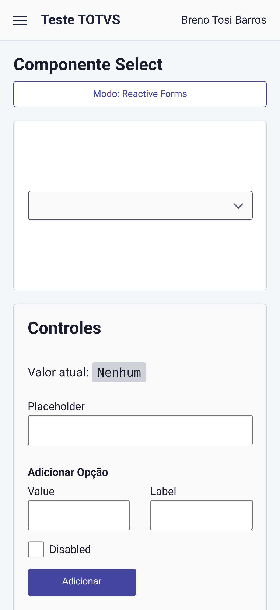

#### Requisitos do desafio

O desafio solicita um Select que:

- Utilize o handoff como referência visual.
- Receba uma lista de opções contendo `value` e `label`.
- Utilize `value` como valor selecionado e `label` como texto apresentado.
- Permita integração com `ngModel` e Reactive Forms.
- Permita desabilitar o campo.

A estrutura das opções aceita pelo componente é:

```typescript
interface SelectOption {
  value: string;
  label: string;
  disabled?: boolean;
}
```

O campo `disabled` foi adicionado para cumprir o teste de option desativada dentro do select.

Exemplo de lista:

```typescript
[
  { value: 'angular', label: 'Angular' },
  { value: 'typescript', label: 'TypeScript' },
  { value: 'scss', label: 'SCSS', disabled: true },
];
```

#### Funcionalidades da demonstração

Na página do Select, é possível:

- Alternar o modo de integração com formulários.
- Personalizar o texto do placeholder.
- Adicionar opções informando valor, texto e estado desabilitado.
- Consultar as opções cadastradas em uma tabela.
- Excluir opções da lista.
- Selecionar uma opção e visualizar o valor atual.
- Desabilitar o componente.
- Ativar o estado visual de erro.

O controle de erro permite demonstrar a aparência desse estado de forma independente das regras de validação de um formulário.

### Estados do Componente

#### Empty

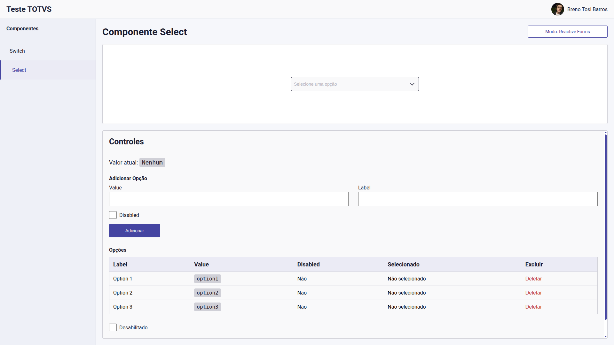

#### Selected

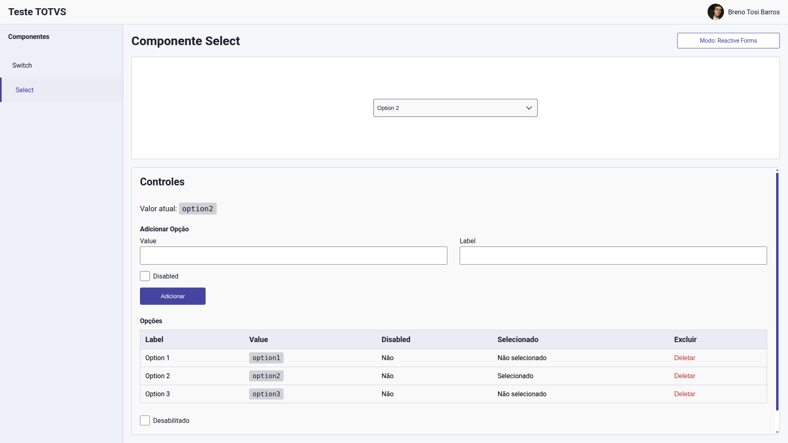

#### Focus

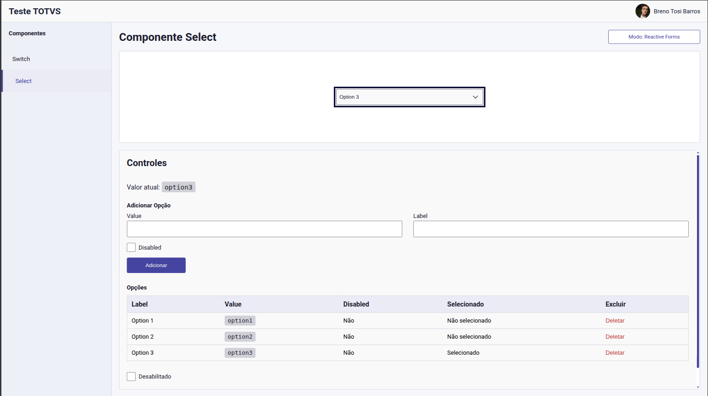

#### Hover


#### Disabled

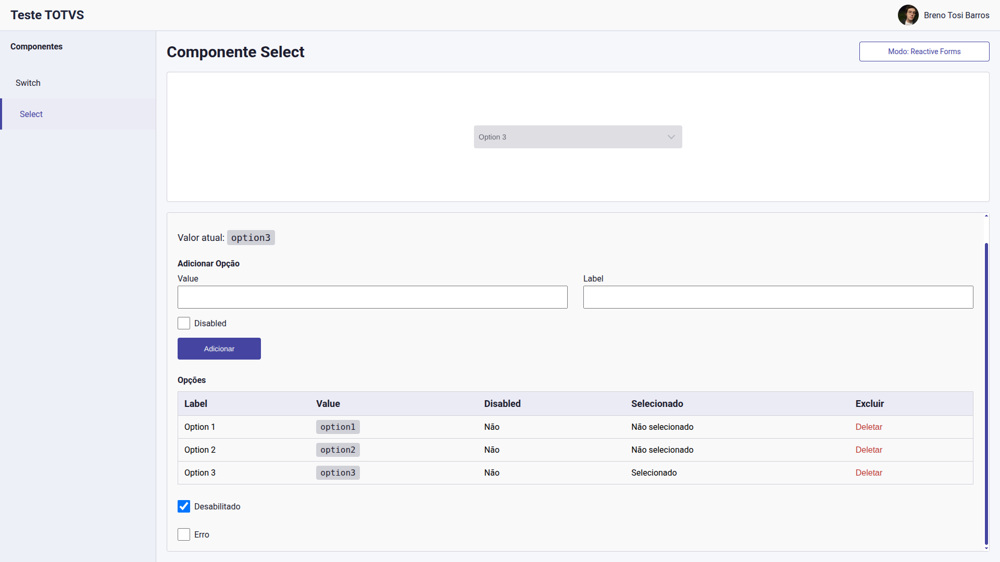

#### Error

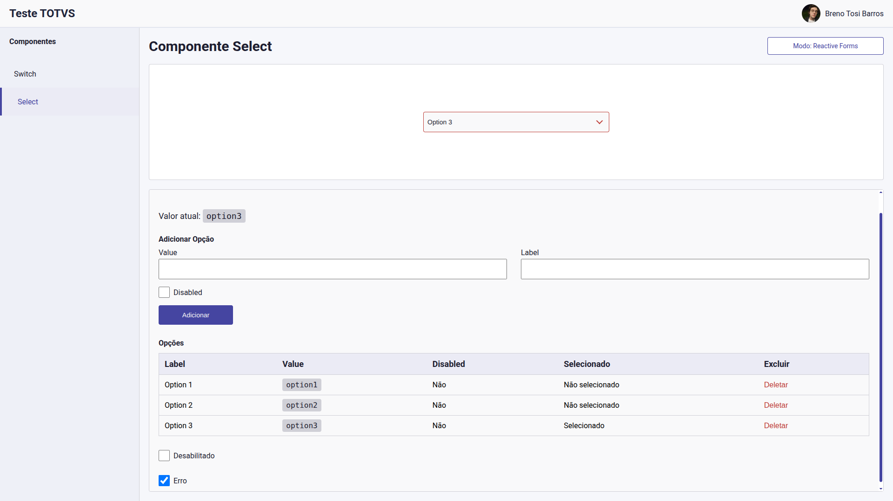

#### Item Selected

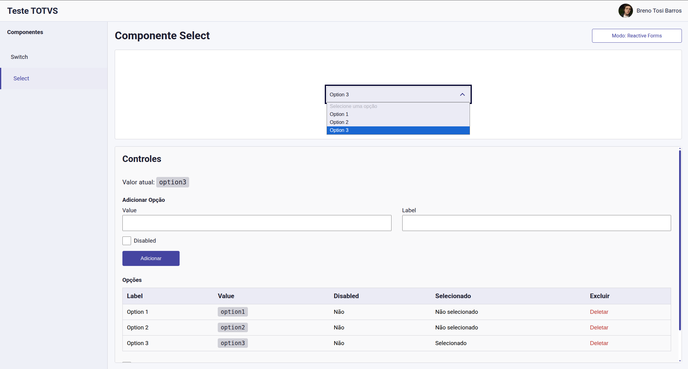

#### Item Disabled

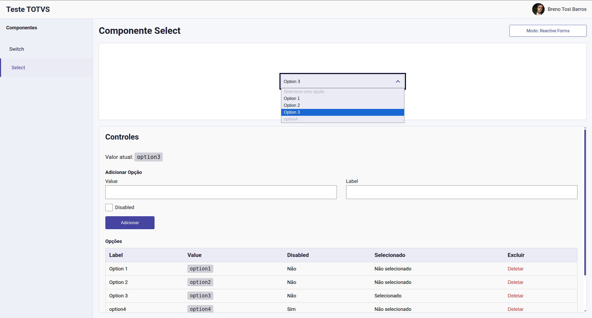

### Switch

#### Desktop


#### Mobile

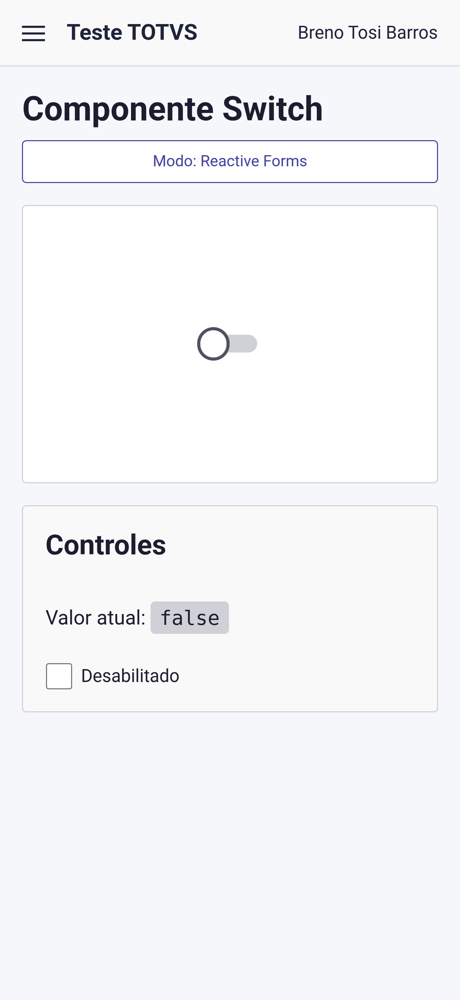

#### Requisitos do desafio

O desafio solicita um Switch que:

- Utilize o handoff como referência visual.
- Permita integração com `ngModel` e Reactive Forms.
- Trabalhe com valores booleanos: `true` e `false`.
- Permita desabilitar o componente.
- Emita um evento informando o valor atual após a interação do usuário.

#### Funcionalidades da demonstração

Na página do Switch, é possível:

- Alternar o modo de integração com formulários.
- Ativar e desativar o Switch.
- Desabilitar o componente.
- Acompanhar o valor informado pelo evento `valueChange`.

O componente utiliza `ControlValueAccessor` para comunicar as alterações ao formulário e disponibiliza o evento `valueChange` para que o consumidor também possa reagir à interação.

### Estados do Componente

#### False


#### True

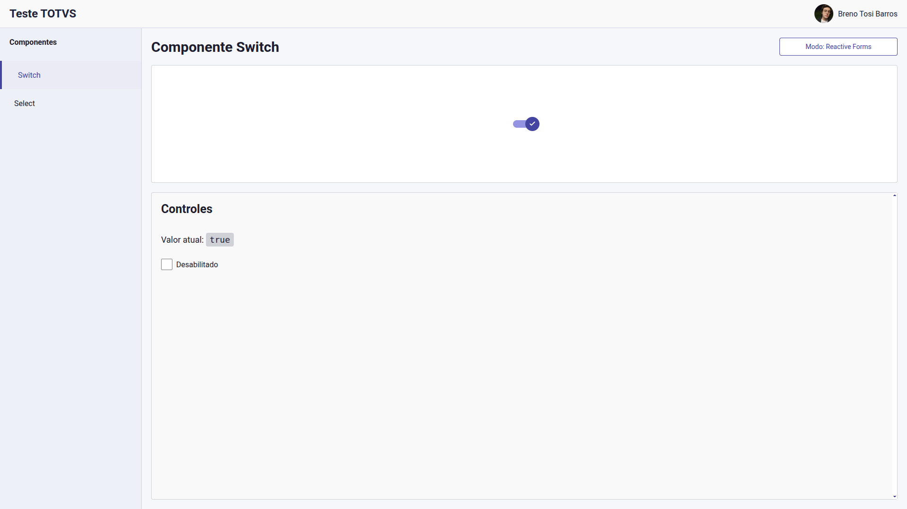

#### Hover

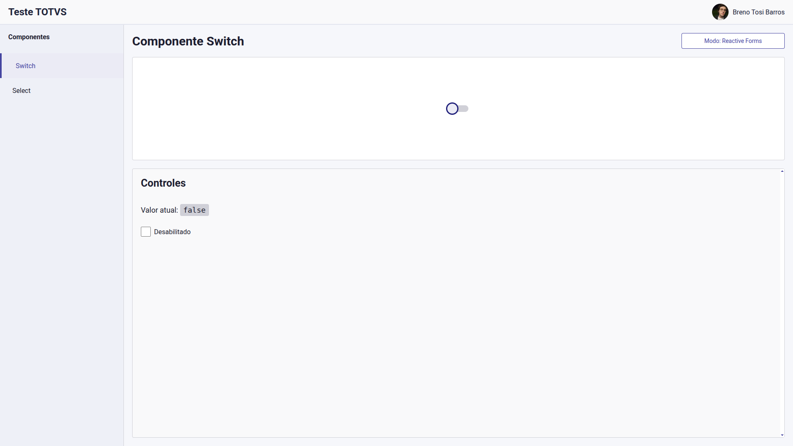

#### Focus

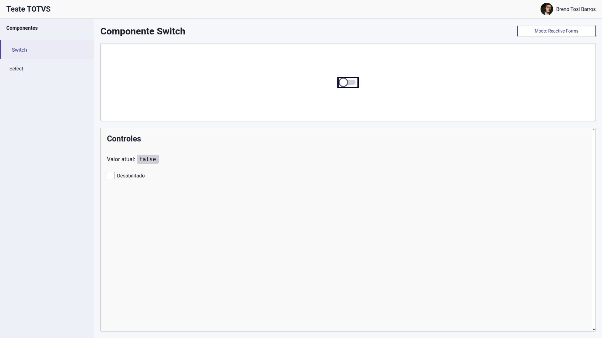

#### Disabled False

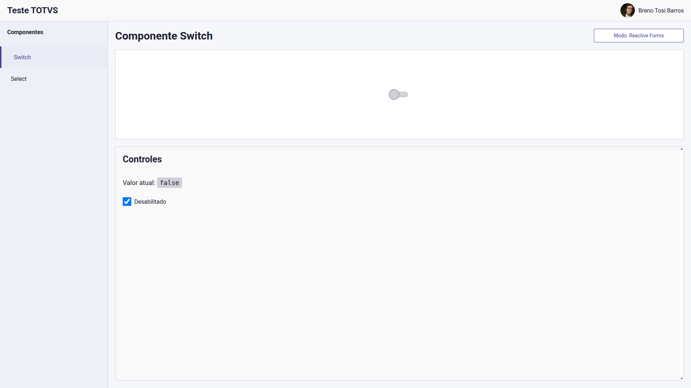

#### Disabled True


## Deploy

A aplicação é hospedada no **GitHub Pages**, com publicação automatizada pelo **GitHub Actions**.

O workflow está definido em:

```text
.github/workflows/deploy.yml
```

A cada push na branch `main`, o workflow executa as seguintes etapas:

1. Obtém o código do repositório.
2. Configura o Node.js na versão `24.16.0`.
3. Instala as dependências com `npm ci`.
4. Gera o build de produção com o caminho base do repositório:

   ```bash
   npm run build -- --base-href=/totvs-test/
   ```

5. Cria uma cópia do `index.html` como `404.html`, utilizada como fallback para acessos diretos às rotas da aplicação.
6. Envia os arquivos de `dist/totvs-test/browser/` como artefato de publicação.
7. Publica o artefato no GitHub Pages.

